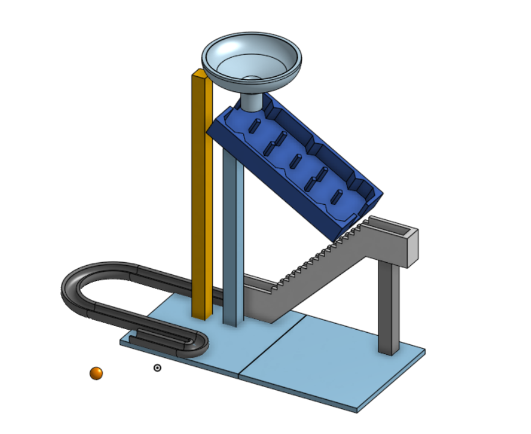
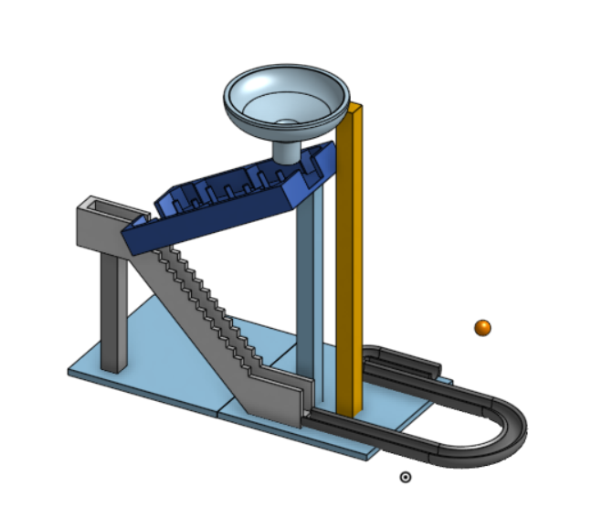

# merbl-run
A custom 3D-printed marble race, designed from scratch!
I used Onshape to design multiple parts and assemble them into the marble run!

I plan to print the parts separately and then glue them together!

Here are some pictures of the marble run!

